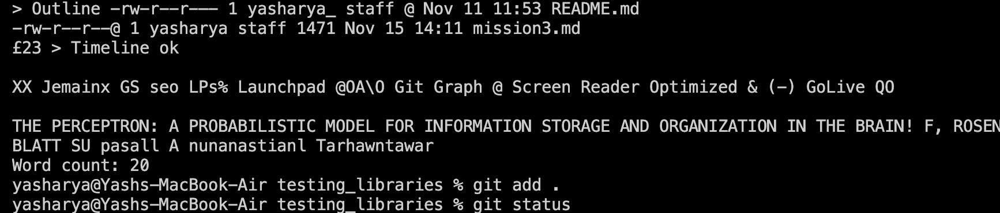

# WORKSHEET-13(B) ASSIGNMENT :

### What it does ?
- In this assigment , I had to create a folder along with python files .

- The use of this assignment to explore two different tools on our own ,I had to select 2 libraries of python out of given list  and read their documentation , use their respective function and make the code run with the help of AI .

- The project made perform tasks like extracting text out of Photo using OCR engine and manipulating image dimensions , formatting , colour channels , then I had to draw boxes around every extracted text and count the words.

### Libraries Used and their Contributions :
#### 1. PILLOW(PIL): 
     - This Library is used to manipulate Images in Python including resezie, channel conversion,, format conversion etc.
     
     - It helped in drawing boxes around extracted text and converting the image channels "RGB" .

#### 2. Pytesseract :
      - This is a Python library, basically a wrapper which helps to communicate to Tesseract (a OCR engine based tool written in c++) via Python.
    
     - It helps to extract text out of photo , so that computer could store it .
     
     - With help of pytesseract , I had extracted text out of a image with help of function
       "image_to_data()" function which Detect the positions of individual words,Visualize the detected text regions on the original image.

### 3.Prerequisites

#### Make sure you have the following installed:

     - Python 3

     - Tesseract OCR

     - Pillow
 
     - pytesseract

### 4.Installation:

##### Install the required Python libraries:

`pip3 install pillow pytesseract`

- Install Tesseract OCR on macOS using Homebrew:

`brew install tesseract`     

### 5. Output Overview:

### 6. Current Limitations

- Handwritten text recognition is not reliably supported.

- Blurry, distorted, or low-resolution images can affect recognition accuracy.

- The program cannot understand the meaning or context of extracted text.

- It does not automatically correct spelling or grammatical errors.

